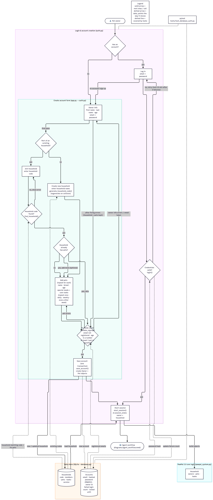

### Original Project
The project that I will be working on is PawPal. This project allow pet owners to keep track of daily tasks for their furry friends. A special feature that I originally added was the household feature, this allows multiple users in one household to add/complete/remove tasks from the task list, providing flexibility on the different owners schedules. 

This project is called PawPal 2.0, it is a system that allows users to keep track of all of their animals’ needs in one page.
#### New to PawPal 2.0 
- AI agent (Google Gemini): plans, makes changes, checks and fixes conflicts, then asks for your approval
- Revise a plan with feedback
- Accounts and login saved in a SQLite database, with a household code to join
- Events & Vacations with away warnings, plus an Availability editor
- Guardrails: draft-only edits, retry limits, version check, login lockout
- 142 automated tests

### Architecture Overview 
My system diagram is split into two diagrams. The first diagram involves logging in and account creation, while the 2nd diagram includes the workflow and the agent workflow . Solid arrows indicate the next step, dotted arrows represent the data moving, and lastly, the dotted lines with no arrow show which parts have automated tests (pytest). 

#### Logging In 



The user has the ability to log in with their email and password, and has up to 5 tries to enter the correct password before the account gets locked. If the user does not have an account, they must create one and include their name, age, email, password, household, pet(s), and tasks (optional). After logging in, each member can set their availability (home hours and a daily care-time limit) in the Availability section. If they would like to join a household, they can fill in the household code provided by the creator of the household; if not, they can create one. Account information must be filled out before accessing the project (minus the initial tasks). Then Accounts are saved in a SQLite database.

#### Workflow 


The user has the option to ask PawPal 2.0 a question, concern, or request, add any events and vacations that will change their saved availability, manually add a task, check out the to-do list of the day, build a schedule, and change the day. The agent will have the ability to fulfill requests made by the user. It ensures there is no overlap or potential issues with scheduling. Before any official changes are made, they are created as suggestions for users to approve. The agent will display a schedule and include an explanation behind this plan. 

### Setup Instructions 

Materials: 
- python 3.10 or higher
- git 
- gemini API key

1. Download project via git:
   ```bash
   git clone https://github.com/jericawan/applied-ai-system-project.git
   cd applied-ai-system-project
   ```

2. Create and activate a virtual environment:

   Mac/Linux:
   ```bash
   python3 -m venv .venv
   source .venv/bin/activate
   ```

   Windows PowerShell:
   ```powershell
   python -m venv .venv
   .\.venv\Scripts\Activate.ps1
   ```

3. Install packages:
   ```bash
   pip install -r requirements.txt
   ```

4. Obtain and set gemini key:
   - Create a free key via Google AI Studio
   - Copy the key
   - In the terminal:

   Mac/Linux:
   ```bash
   export GEMINI_API_KEY="your-key"
   ```

   Windows PowerShell:
   ```powershell
   $env:GEMINI_API_KEY="your-key"
   ```

5. Run App/Sample command executions:
   ```bash
   python -m streamlit run app.py
   ```

   a. Command line demo:
   ```bash
   python main.py
   ```

   b. Run tests:
   ```bash
   python -m pytest
   ```
   c. run only AI agent tests: 
   ```bash
   python -m pytest tests/test_agent.py -v
   ```


### Sample Inputs/Outputs

These were run in the Streamlit app, logged in as the practice household "The Williams Home" (members Alex and Adams Williams, pets Buddy and Luna). Each output is copied from the app. The schedule is shown in the app's "Why this plan" format. I did ask Claude to correct the broken tables that showed the plan. 


#### Example 1: Question only (no changes)
**Input:** "whats on today's schedule?"

**Output:**
```
Today's schedule includes Buddy's morning walk at 07:30, feeding Luna at 08:00, Buddy's hip
supplement at 12:00, evening fetch at 18:00, plus cleaning Luna's litter box and brushing her
at any convenient time.

Daily plan for the The Williams Home household:
  07:00-07:10  Clean litter box (Luna) -> Alex Williams  [priority 2, earliest free slot]
  07:10-07:25  Brushing (Luna) -> Alex Williams  [priority 3, earliest free slot]
  07:30-08:00  Morning walk (Buddy) -> Alex Williams  [must be done at 07:30]
  08:00-08:10  Feed Luna (Luna) -> Alex Williams  [must be done at 08:00]
  12:00-12:05  Hip supplement (Buddy) -> Alex Williams  [must be done at 12:00]
  18:00-18:20  Evening fetch (Buddy) -> Alex Williams  [must be done at 18:00]
```
**Result:** Pass. The agent recognized a question, answered it and made no changes, so there was nothing to approve.

#### Example 2: Add a new pet and suggested tasks
**Input:** "Add a pet Tuna who is a 2 year old shih tzu who needs to be walked everyday at least once, and needs a shower every other week. Give me suggested tasks"

**Output:**
```
I will add Tuna to the household and set up daily walks, biweekly showers, and regular daily feedings.

Daily plan for the The Williams Home household:
  07:00-07:20  Walk Tuna (Tuna) -> Alex Williams  [priority 1, earliest free slot]
  07:20-07:30  Feed Tuna (Tuna) -> Alex Williams  [priority 1, earliest free slot]
  07:30-08:00  Morning walk (Buddy) -> Alex Williams  [must be done at 07:30]
  08:00-08:10  Clean litter box (Luna) -> Alex Williams  [priority 2, earliest free slot]
  08:10-08:25  Brushing (Luna) -> Alex Williams  [priority 3, earliest free slot]
  08:25-08:55  Shower Tuna (Tuna) -> Alex Williams  [priority 3, earliest free slot]
  18:00-18:20  Evening fetch (Buddy) -> Alex Williams  [must be done at 18:00]
```
**Result:** Pass. The agent called `add_pet` first, then added a daily walk, a biweekly shower and a suggested daily feeding for Tuna. The changes waited for approval before being saved.

#### Example 3: Someone goes on vacation, tasks reassigned
**Input, step 1 (manual):** under Events & Vacations, added "Aruba" for Alex Williams, Nov 14–Nov 20.

**Output, step 1 (away warnings):**
```
🧳 Alex Williams will be unavailable for 34 task(s): Morning walk (Sun Nov 15), Evening fetch
   (Sun Nov 15), Clean litter box (Sun Nov 15), Brushing (Sun Nov 15), Morning walk (Mon Nov 16),
   and 29 more. Reassign them or ask PawPal 2.0 to.

To-Do List · Sunday, Nov 15 — 3 of 7 done
🧳 Alex Williams is away (Aruba, Nov 14-Nov 20) and can't do 'Morning walk' on Sun Nov 15 at 07:30 AM.
🧳 Alex Williams is away (Aruba, Nov 14-Nov 20) and can't do 'Evening fetch' on Sun Nov 15 at 06:00 PM.
🧳 Alex Williams is away (Aruba, Nov 14-Nov 20) and can't do 'Clean litter box' on Sun Nov 15.
🧳 Alex Williams is away (Aruba, Nov 14-Nov 20) and can't do 'Brushing' on Sun Nov 15.
```

**Input, step 2 (AI request):** "reassign tasks while alex is gone"

**Output, step 2:**
```
I will reassign all of Alex's pet care tasks to Adams while Alex is away.

Daily plan for the The Williams Home household:
  00:00-00:10  Clean litter box (Luna) -> Adams Williams  [priority 2, earliest free slot]
  00:10-00:25  Brushing (Luna) -> Adams Williams  [priority 3, earliest free slot]
  07:30-08:00  Morning walk (Buddy) -> Adams Williams  [must be done at 07:30]
  18:00-18:20  Evening fetch (Buddy) -> Adams Williams  [must be done at 18:00]
```
**Result:** Pass. The app warned that Alex would be away, and the agent moved every one of Alex's tasks to Adams. The flexible tasks landed at 12:00 AM because Adams had no home hours set (see the note at the top).

#### Example 4: Guardrail, scheduling conflict
**Input:** "add a task to feed Buddy at 12 AM." (Another task already used the 12:00 AM slot.)

**Output:**
```
I'll add a new task to feed Buddy at 12:00 AM.

Fixed conflicts in 1 round(s).

Daily plan for the The Williams Home household:
  00:00-00:10  Feed Buddy (Buddy) -> Adams Williams  [must be done at 00:00]
  00:10-00:20  Clean litter box (Luna) -> Adams Williams  [priority 2, earliest free slot]
  00:20-00:35  Brushing (Luna) -> Adams Williams  [priority 3, earliest free slot]
  07:30-08:00  Morning walk (Buddy) -> Adams Williams  [must be done at 07:30]
  18:00-18:20  Evening fetch (Buddy) -> Adams Williams  [must be done at 18:00]
```
**Result:** Pass. The check step found the overlap at 12:00 AM. The fix step moved the flexible tasks (litter box, brushing) to later slots so the fixed-time feeding kept 12:00 AM. It took 1 fix round, and no conflicts were left.

#### Example 5: Change a schedule, then revise with feedback
**Input:** "Add a bathing schedule for each pet at 12:30 to 1 pm"

**Output (first plan):**
```
Daily plan for the The Williams Home household:
  00:00-00:10  Clean litter box (Luna) -> Adams Williams  [priority 2, earliest free slot]
  00:10-00:25  Brushing (Luna) -> Adams Williams  [priority 3, earliest free slot]
  07:30-08:00  Morning walk (Buddy) -> Adams Williams  [must be done at 07:30]
  12:30-12:45  Bathing (Buddy) -> Adams Williams  [must be done at 12:30]
  12:45-13:00  Bathing (Luna) -> Adams Williams  [must be done at 12:45]
  18:00-18:20  Evening fetch (Buddy) -> Adams Williams  [must be done at 18:00]
```

**Feedback (Revise with feedback):** "Baths should be on different days and 30 minutes each"

**Output (revised plan):**
```
I will schedule Buddy's 30-minute bath for today at 12:30 pm and keep Luna's bath for a different day.

  12:00 AM - 12:10 AM  Clean litter box (Luna) -> Adams Williams  [priority 2, earliest free slot]
  12:10 AM - 12:25 AM  Brushing (Luna) -> Adams Williams  [priority 3, earliest free slot]
  12:25 AM - 12:55 AM  Bathing (Luna) -> Adams Williams  [priority 3, earliest free slot]
  07:30 AM - 08:00 AM  Morning walk (Buddy) -> Adams Williams  [must be done at 07:30]
  12:30 PM - 01:00 PM  Bathing (Buddy) -> Adams Williams  [must be done at 12:30]
  06:00 PM - 06:20 PM  Evening fetch (Buddy) -> Adams Williams  [must be done at 18:00]
```
### Reliability/guardrail results 
(.venv) (base) jericawan@MacBook-Air applied-ai-system-project % python main.py
Sign-up
========================================
Created household code LI9K0K; Jo and Sam are members
Duplicate email: ['An account with this email already exists.']

Login
========================================
Wrong password: Email or password is incorrect.
Right password: Welcome back!

Saved to database: version 3, 8 tasks, 2 members

Today's Schedule
========================================
07:30 AM - 08:00 AM  Morning walk (Biscuit) [priority 1]
08:15 AM - 08:25 AM  Breakfast (Mochi) [priority 1]
10:00 AM - 10:20 AM  Grooming (Biscuit) [priority 2]
10:00 AM - 10:15 AM  Vet call (Biscuit) [priority 1]
12:00 PM - 12:05 PM  Joint medicine (Biscuit) [priority 1]
03:00 PM - 03:10 PM  Clean litter box (Mochi) [priority 2]
06:00 PM - 06:20 PM  Evening fetch (Biscuit) [priority 2]
08:00 PM - 08:15 PM  Brushing (Mochi) [priority 3]
WARNING: Biscuit double-booked: 'Grooming' at 10:00 overlaps 'Vet call' at 10:00

Version check: Household LI9K0K was changed by another member since version 3.

(Run with --agent to send a request to the AI agent.)


Tasks in the order they were added
========================================
07:30  Morning walk
12:00  Joint medicine
18:00  Evening fetch
08:15  Breakfast
15:00  Clean litter box
20:00  Brushing
10:00  Grooming
10:00  Vet call

Tasks sorted by time
========================================
07:30  Morning walk
08:15  Breakfast
10:00  Grooming
10:00  Vet call
12:00  Joint medicine
15:00  Clean litter box
18:00  Evening fetch
20:00  Brushing

Completed today: ['Morning walk']
Still to do: ['Joint medicine', 'Evening fetch', 'Breakfast', 'Clean litter box', 'Brushing', 'Grooming', 'Vet call']
Mochi's tasks: ['Breakfast', 'Clean litter box', 'Brushing']

### Design Decisions 

I wanted to priortize having different users in the household being able to add, complete or remove tasks. This provides a realistc aspect for families with different schedules that helps out with the family pets. I wanted to include availability changes whether someone in the household goes on vacation or gets a new job, requiring a new availability. A tradeoff in my project is the greedy scheduling process. The ordering decisions are not very complex and usually tasks that are put it in first will get early priority. 

### Testing Summary 
What I felt like worked was the correction loop that the agent follows. First it allows the user to descrbe their plan, then the agent will create a schedule then asks the user for any suggestions, reject or acccept the changes. A highlight of what worked is that any changes made must be approved from the user. This ensures that the user fully understands is and is in the loop of the decision. At first I didn't have the necessay tools needed for the basics of this project. An example of this was changing the user's availability. At first the only time it was possible to set the availability was during account creation. I was able to catch this early on and change the app design to allow the user to change their availability. Another thing that didn't work is the time availability for those who do not put their availabiliy in account creation. This will automatically set users to do tasks for their pets at midnight as they assume that they are available the whole day no matter the time. This aspect was not considered when designing this project. What I learned about using AI to create a project like this is the need for context in order to produce the desired outcome. Without specific directions of what is okay and not okay it would just leave holes in the decisions making process. I found that going back and considering all edge cases make a significant impact on my work. 

### Reflection
This project taught me how to work with AI to the best of my advantage. Before I was unsure when to accept or decline code or changes made by AI due to the previous experiences with it. But being able to understand the different components of training AI to build something that I have planned out is extremely interesting. It gives insight on things I personally have not thought baout when designing my system while I learn to bounce ideas off of the content that the AI provides. 